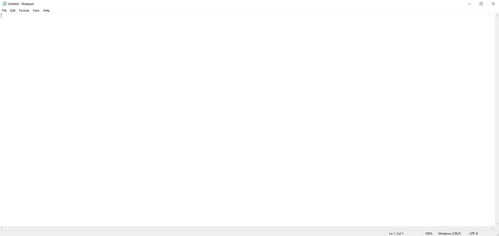

# XOR Payload Loader

Windows x64 lab with a self-generated `notepad.exe` payload.

`encryptor.cpp` encrypts the payload with XOR key `0x5A`.  
`loader.cpp` decrypts it, copies it into RW memory, changes the protection to RX, and runs it with `CreateThread`.

The payload runs only inside the loader process.

## Files

```text
encryptor.cpp   — encrypts the original payload
loader.cpp      — decrypts and executes it
screenshots/    — result
```

## Build and run

Use x64 Native Tools Command Prompt or another terminal with MSVC configured.

Build and run the encryptor:

```bat
cl /std:c++20 /EHsc /W4 encryptor.cpp /Fe:encryptor.exe
encryptor.exe
```

It prints the encrypted payload:

```text
\xA6\x12\xD9\xBE\xAA\xB2...
```

Paste the full output into the payload array in `loader.cpp`, then build and run the loader:

```bat
cl /std:c++20 /EHsc /W4 loader.cpp /Fe:loader.exe
loader.exe
```

Notepad should open.

## Notes

XOR is applied twice with the same key:

```text
FC 48 83 E4 → A6 12 D9 BE → FC 48 83 E4
```

The payload size is set explicitly:

```cpp
constexpr std::size_t payloadSize = 276;
```

`sizeof(payload)` returns 277 because the string literal adds a trailing `\0`. The useful payload is 276 bytes.

Memory is allocated as `PAGE_READWRITE` and changed to `PAGE_EXECUTE_READ` after `std::memcpy`.

Single byte XOR is used here only to demonstrate reversible byte transformation.

## Result

