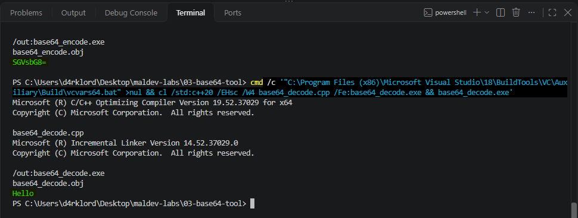

# Base64 Encoder and Decoder

- `base64_encode.cpp`: `Hello → SGVsbG8=`
- `base64_decode.cpp`: `SGVsbG8= → Hello`

## Build and run

Use x64 Native Tools Command Prompt or another terminal with MSVC configured.

Encode:

```bat
cl /std:c++20 /EHsc /W4 base64_encode.cpp /Fe:base64_encode.exe
base64_encode.exe
```

Decode:

```bat
cl /std:c++20 /EHsc /W4 base64_decode.cpp /Fe:base64_decode.exe
base64_decode.exe
```

Expected output:

```text
SGVsbG8=
Hello
```

## Notes

Base64 is encoding, not encryption. No key is required.

The `=` character is padding. It's used when the input length is not a multiple of three bytes.

After decoding, `outputSize` contains the number of bytes written to the output buffer. For `Hello`, it's 5.

## Result

